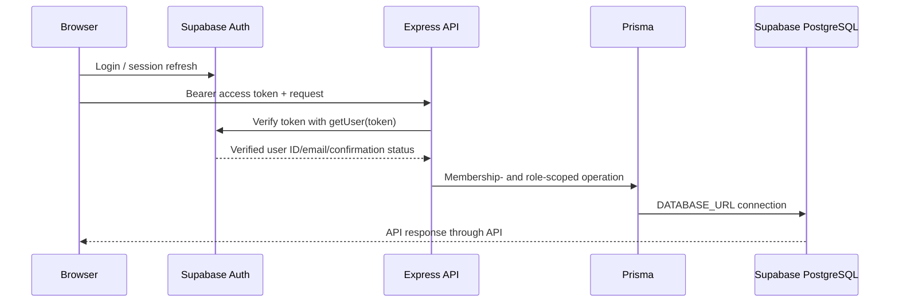

# AccessLens AI Architecture

## v1.3.0 runtime boundaries

- **Web:** `apps/web` is a Next.js App Router application. Supabase SSR middleware refreshes session cookies and protects authenticated routes. Browser API calls send the Supabase access token to the API.
- **Auth:** Supabase Auth handles passwords, session management, email confirmation, and password recovery. PKCE callbacks exchange codes through `/auth/callback`.
- **API:** `apps/api` verifies bearer tokens with Supabase Auth `getUser(token)`. It derives the profile identity and confirmed-email status from the verified user, then enforces membership and role constraints for team, project, and dashboard operations.
- **Database:** `packages/database` owns the Prisma schema, generated client, migrations, and RLS policy SQL. Runtime queries use `DATABASE_URL`; migrations use `DIRECT_URL`.
- **Teams:** The Teams page calls authenticated team/member/invitation APIs. Invitation tokens are random, hashed at rest, expire after seven days, and require a matching confirmed email on acceptance. Optional Resend email is sent only by the API; persisted email status distinguishes unconfigured, pending, provider-accepted, and failed attempts.
- **Projects/dashboard:** Team-assigned projects are readable by current members; OWNER/ADMIN/DEVELOPER can create or edit and OWNER/ADMIN can delete. Dashboard aggregates include authorized personal and team projects.
- **Scanner:** The API persists scan requests in PostgreSQL and a worker atomically claims queued work. Playwright runs in a fresh sandboxed browser context, while a local egress proxy pins outbound connections to a public address validated for the exact project origin. axe-core results are normalized and stored as findings. The API returns queued status and the web page polls the authenticated status endpoint.
- **Shared types:** `packages/shared` contains package-shared domain types.
- **Visual Agent:** `devtools/visual-agent-overlay` is dynamically loaded only in development behind an explicit opt-in. It copies a structured prompt and has no undocumented Antigravity integration or production behavior.

## Request/data flow

The API database user is trusted and privileged; its ownership, membership, and role filters are mandatory. RLS is enabled in migrations; profile self-read/safe-insert and personal-project owner policies exist, while team projects, teams, invitations, scans, and findings are accessed through the API authorization boundary.

The dashboard returns no generated/sample statistics. Its period selector filters daily trends to the last 7, 30, or 90 UTC calendar days; aggregate cards cover all persisted records the user is authorized to see. Its score is the rounded average of the latest completed stored scan score per authorized project and is explicitly not a WCAG compliance claim. Recent activity remains empty until application flows write `ActivityLog` records.

## Deployment

The intended targets are Vercel for `apps/web`, Render for `apps/api`, and Supabase for PostgreSQL/Auth. Deployment files are examples and have not been used for a live deployment.
