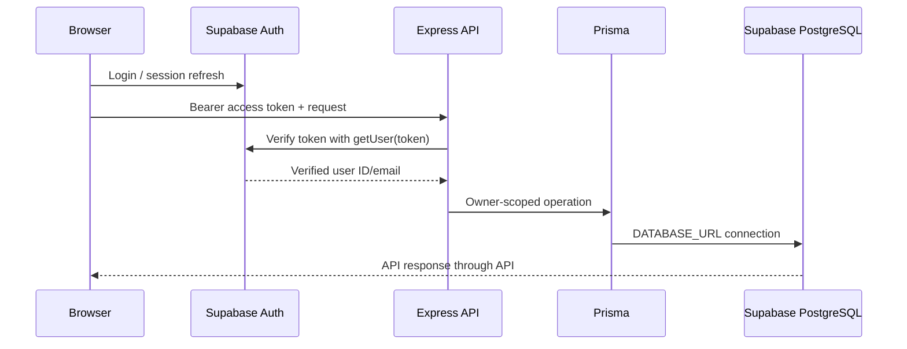

# AccessLens AI Architecture

## v1.1.0 runtime boundaries

- **Web:** `apps/web` is a Next.js App Router application. Supabase SSR middleware refreshes session cookies and protects authenticated routes. Browser API calls send the Supabase access token to the API.
- **Auth:** Supabase Auth handles passwords, session management, email confirmation, and password recovery. PKCE callbacks exchange codes through `/auth/callback`.
- **API:** `apps/api` verifies bearer tokens with Supabase Auth `getUser(token)`. It derives the profile identity from the verified user and applies owner constraints for profile/project operations.
- **Database:** `packages/database` owns the Prisma schema, generated client, migration, and RLS policy SQL. Runtime queries use `DATABASE_URL`; migrations use `DIRECT_URL`.
- **Shared types:** `packages/shared` contains package-shared domain types.
- **Visual Agent:** `devtools/visual-agent-overlay` remains outside application imports and business logic.

## Request/data flow

The API database user is trusted and privileged; its owner filters are mandatory. RLS is enabled in the initial migration; profile self-read/safe-insert and project-owner policies exist, and future-module tables deny direct client access until policies are designed.

## Deployment

The intended targets are Vercel for `apps/web`, Render for `apps/api`, and Supabase for PostgreSQL/Auth. Deployment files are examples and have not been used for a live deployment.
