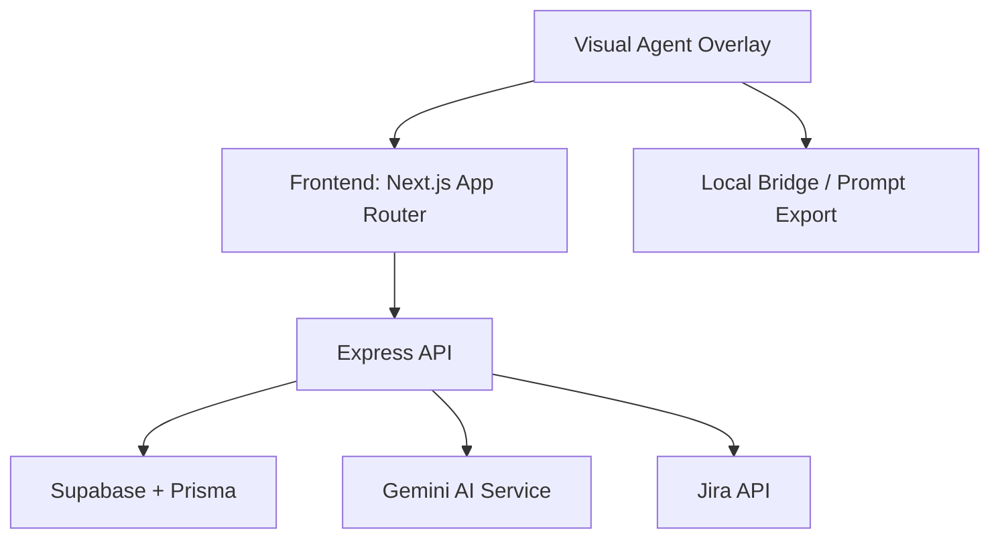
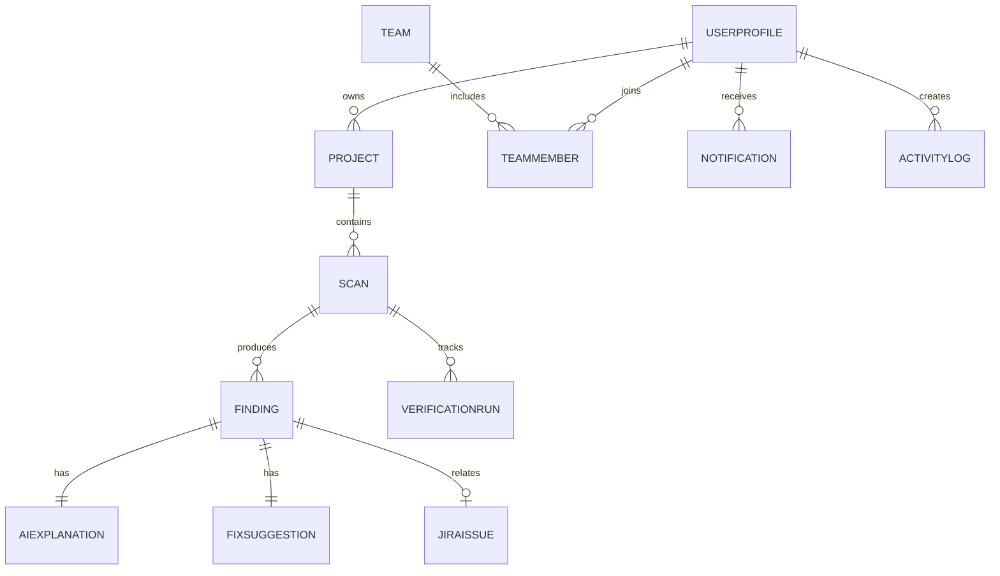
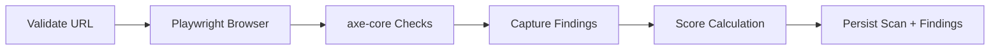
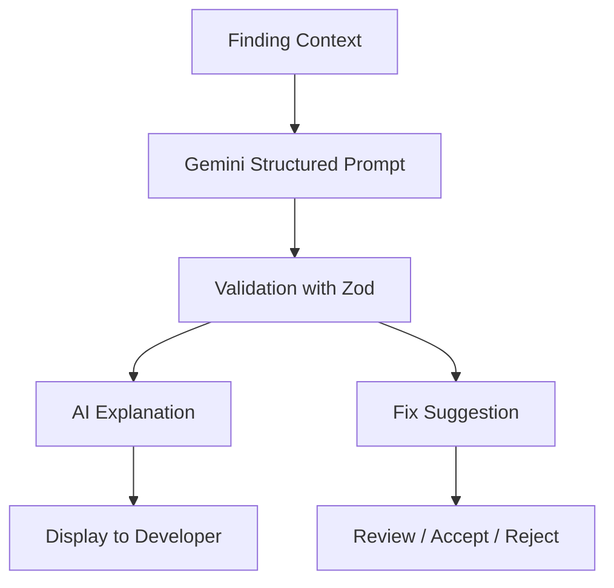
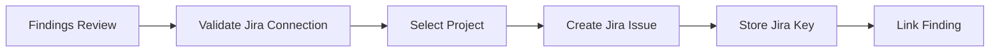
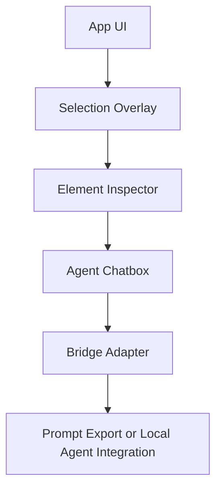
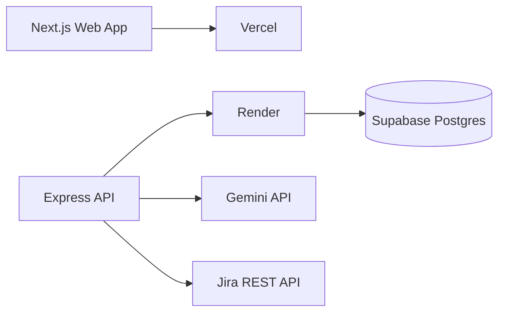

# AccessLens AI Project Knowledge Map

## 1. Project overview
AccessLens AI is an AI-powered accessibility SaaS platform for monitoring website accessibility across projects, scanning pages with Playwright and axe-core, explaining violations with Gemini, suggesting code changes, tracking verification, and integrating with Jira and team workflows.

## 2. Monorepo architecture

## 3. Complete folder structure
- `apps/web` — Next.js frontend
- `apps/api` — Express backend APIs
- `packages/shared` — common types and constants
- `packages/database` — Prisma schema and client layer
- `devtools/visual-agent-overlay` — isolated overlay package.
- `docs` — project knowledge and version control docs
- `scripts` — operational scripts and safe removal workflow

## 4. Module responsibilities
### Frontend modules
- Dashboard: summary of scan trends and score metrics
- Projects: project CRUD and scan history
- Scanner: trigger scans and review findings
- Findings: issue severity, status, and fix workflow
- AI fixes: explanation and code suggestions
- Verification: re-scan comparison and regression detection
- Jira: issue creation and sync
- Analytics: trend reporting and export
- Team: invites and permissions
- Notifications: scan and project updates

### Backend modules
- Auth: register, login, protected routes, token validation
- Projects: project persistence and ownership rules
- Scanner: safe URL validation and scan orchestration
- Findings: issue persistence and filters
- AI: Gemini integration and structured results
- Verification: regression detection and status validation
- Jira: connection, issue creation, and syncing
- Analytics: aggregated metrics and exports
- Team: membership and permissions
- Notifications: push updates and activity records

## 5. Frontend component relationships
The frontend is built around a modular dashboard and feature-based layout. The main shell loads project metrics and uses individual feature modules for scans, insights, AI explanations, and issue reporting.

## 6. Backend API relationships
The API layer handles authentication, project management, scanner orchestration, AI explanations, verification, Jira actions, analytics, notifications, and team management. Each module is expected to validate body payloads with Zod and return structured JSON errors.

## 7. Database relationships

## 8. Important business logic
- Only authorized users can view project data
- All scan operations must validate URLs and block SSRF sources
- AI results must be structured and validated before use
- Jira issues should be deduplicated before creation
- Verification should only resolve findings when re-scan evidence confirms it

## 9. Accessibility scanning logic
A scan begins by validating URL safety, then loads the site in Playwright, runs axe-core, records violations, attaches selectors and HTML snippets, and stores findings with severity and status information.

## 10. AI processing flow

## 11. Code suggestion workflow
The AI service inspects the relevant HTML, selector, and issue context; it generates a before/after code pair; and the user can copy or accept the suggestion without modifying the production site directly.

## 12. Verification and regression logic
A verification run compares current findings against a later scan. Resolved issues are marked only when the re-scan proves they are gone, while new or repeated violations are treated as regressions.

## 13. Jira integration logic
The connected Jira team stores an integration and project key. When a finding is created or reviewed, the app may create a Jira issue; the key and issue metadata are saved and linked to the relevant finding to avoid duplicate work.

## 14. Team and notification logic
Teams have members with roles and permissions. Notifications are generated when a scan completes, a critical issue is found, a Jira issue is created, verification finishes, or project activity occurs.

## 15. Visual Agent architecture
The visual agent is intentionally isolated in `devtools/visual-agent-overlay` to keep it outside the business layers. It is turned on only in development and disabled by default in production.

## 16. Antigravity bridge design
The adapter is designed to use only supported integration paths when available. If direct API compatibility is not available, the overlay provides context export and a copyable prompt for the coding agent rather than inventing unsupported automation.

## 17. Deployment architecture

## 18. Environment variable purposes
- `NEXT_PUBLIC_SUPABASE_URL` — frontend Supabase URL
- `NEXT_PUBLIC_SUPABASE_ANON_KEY` — frontend anon key
- `NEXT_PUBLIC_API_URL` — API base URL
- `DATABASE_URL` — Prisma/Postgres connection string
- `DIRECT_URL` — direct DB connection for migrations
- `SUPABASE_SERVICE_ROLE_KEY` — backend-only privileged access
- `GEMINI_API_KEY` — AI issue explanations and suggestions
- `JIRA_CLIENT_ID` / `JIRA_CLIENT_SECRET` — Jira OAuth credentials
- `VISUAL_AGENT_ENABLED` — dev-only overlay switch

## 19. Dependencies
- Next.js 14
- React 18
- Tailwind CSS
- Recharts
- Express
- Prisma
- Supabase Postgres
- Playwright + axe-core
- Zod
- Gemini-ready API layer

## 20. Completed and pending features
Completed:
- monorepo scaffolding
- frontend dashboard shell
- backend API shell
- Prisma schema
- docs scaffold
- overlay package scaffold
- removal workflow stub

Pending:
- full auth flows with Supabase
- real database migrations and RLS rules
- full scanner engine
- AI integration with Gemini
- Jira OAuth and project sync
- analytics exports
- full overlay selector behavior
- production-grade testing and deployment config

## 21. Known limitations
- Live external services are not connected yet
- Actual Supabase credentials are required for production use
- The visual agent is development-only and intentionally not wired into the business application
- This scaffold is a real baseline, not a fake completion of every external integration

## 22. Architecture decisions
- Keep the overlay outside permanent application logic
- Use zod validation for request safety
- Keep the monorepo modular and easier to reproduce
- Prefer documented adapter patterns over unsupported automation
- Maintain explicit safety checks for URL scans and AI-generated code

## 23. Versioned work expectations
Whenever a new logical prompt is implemented, update the version in `docs/control.md`, add a new changelog entry, and document the changes here.
