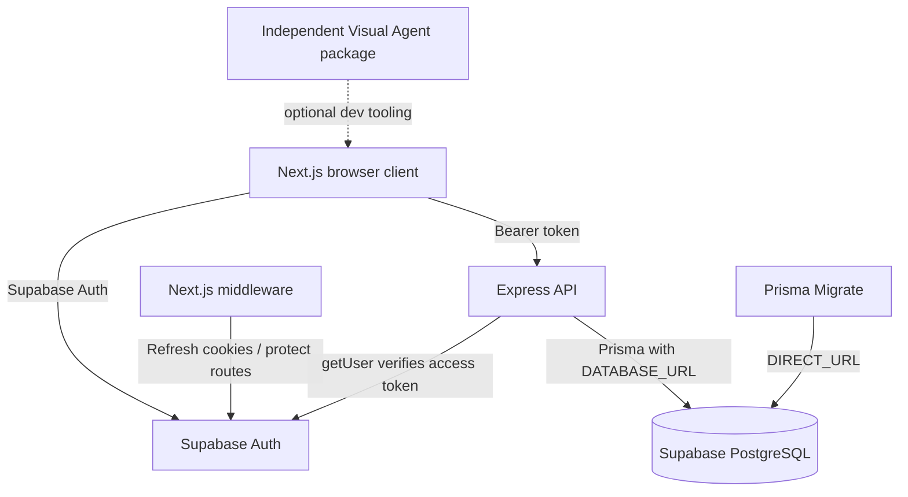
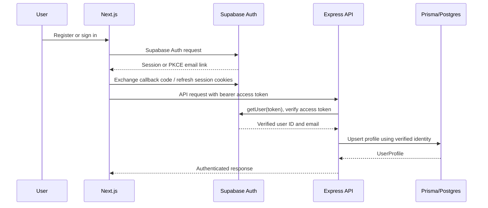
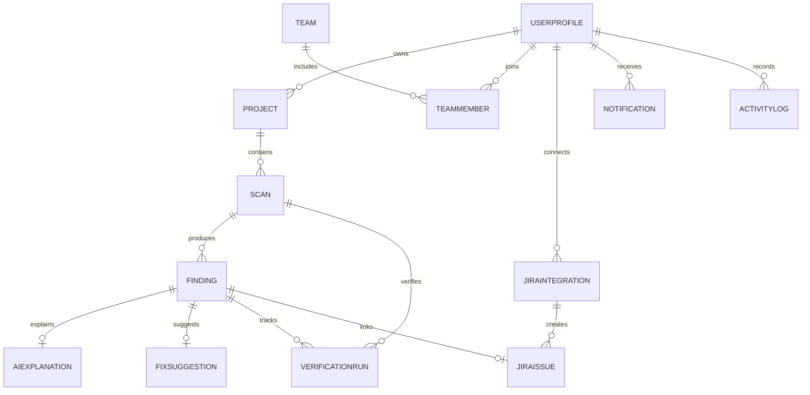
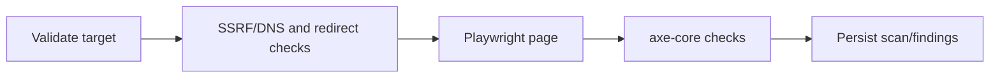
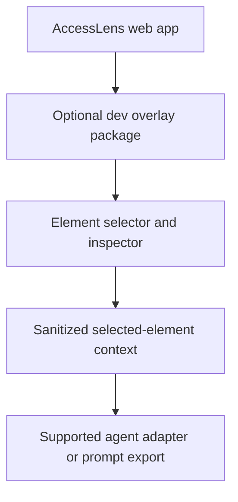
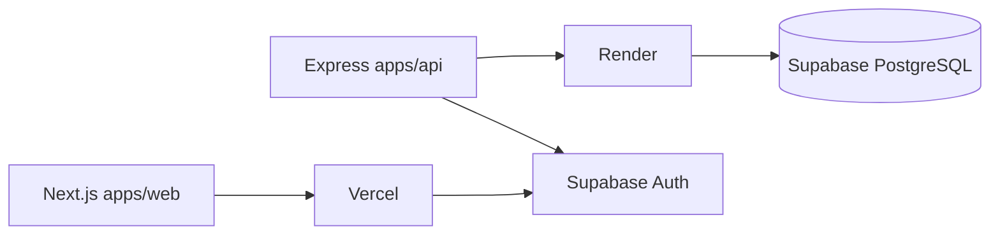

# AccessLens AI Project Knowledge Map

**Current development version:** v1.3.0 plus local phases 10–15
**Status:** The working tree includes scanner/findings, verification, Gemini assistance, Jira integration, and the development-only Visual Agent overlay. Phase 15 extends the existing overlay. Local implementation and automated checks do not imply live provider, staging, or production verification; consult `docs/testing.md` for exact evidence and migration status.

## 1. Project overview

AccessLens AI is a modular accessibility SaaS monorepo. Its existing product includes Supabase Auth, projects/teams, accessibility scanning and findings, fix verification, Gemini guidance, Jira Cloud issue handling, notifications, and reporting/analytics features. External service and database behavior still require separate live verification.

The Visual Agent is a separate, optional package in `devtools/visual-agent-overlay`. The web app dynamically loads it only for opted-in development; production builds alias the package to an empty stub.

## 2. Monorepo structure

```text
apps/
  web/
    src/app/                 Next.js App Router routes and layouts
    src/components/          Auth and app-shell components
    src/lib/                 Supabase browser client and API helper
    src/middleware.ts        Supabase cookie refresh and route protection
  api/
    src/app.ts               Testable Express app and implemented REST routes
    src/main.ts              Environment loading, Prisma connection, HTTP lifecycle
    src/modules/             Auth and repository contracts
    src/services/            Prisma-backed repository
    src/__tests__/           API authorization and CRUD integration tests
packages/
  database/
    prisma/schema.prisma     PostgreSQL enums and models
    prisma/migrations/       Initial PostgreSQL migration and RLS policies
    src/client.ts            Reused Prisma client and connection lifecycle
  shared/src/                Shared product types and module constants
devtools/
  visual-agent-overlay/      Independent development-only package
docs/                        Project architecture, API, database, deployment, control
scripts/                      Operational scripts
```

## 3. System architecture



## 4. Frontend modules and relationships

### Authentication
- **Purpose:** Registration, login, logout, email confirmation, and password recovery.
- **Path:** `apps/web/src/app/(auth)/`, `apps/web/src/components/auth/`, `apps/web/src/lib/supabase/`
- **Components:** `AuthForm`, browser Supabase client, callback route, auth route group.
- **APIs/models:** Supabase Auth; the API creates `UserProfile` on first verified API request.
- **Logic:** Supabase SSR uses PKCE and cookie-based sessions. Email verification and password recovery exchange their code through `/auth/callback`.
- **Dependencies:** `@supabase/ssr`, Supabase project configuration.
- **Related modules:** API auth middleware, profile, protected app shell.

### Protected application shell
- **Purpose:** Responsive navigation, profile summary, and logout action.
- **Path:** `apps/web/src/app/(app)/`, `apps/web/src/components/app-shell/`
- **Components:** `AppShell`, `FeaturePlaceholder`, profile/settings navigation, accessible toast provider.
- **APIs/models:** `GET /api/profile` backed by `UserProfile`.
- **Logic:** `src/middleware.ts` checks Supabase Auth for application routes. Future module routes show an explicit not-implemented state rather than invented data.
- **Dependencies:** Supabase browser client and API helper.
- **Related modules:** Profile, projects, all future app pages.

### Dashboard
- **Purpose:** Show authenticated workspace project, scan, finding, severity, recent activity, and persisted scan-score metrics.
- **Path:** `apps/web/src/app/(app)/dashboard/`
- **Components:** Time-range selector, summary cards, scan/finding trend chart, severity chart, project performance, recent scans/activity, and empty/loading/error states.
- **APIs/models:** `GET /api/dashboard/summary?range=7d|30d|90d`; `Project`, `Scan`, `Finding`, `ActivityLog`.
- **Logic:** The API aggregates only rows associated with the verified profile's personal projects or current team memberships. Scan/finding daily trends use the selected UTC calendar range. Empty records render as empty states. Accessibility score averages each authorized project's latest completed persisted scan score; it is absent until such scores exist and does not indicate WCAG compliance.
- **Dependencies:** API helper and existing Recharts dependency.
- **Related modules:** Projects, scanner and activity logging.

### Projects
- **Purpose:** Create, list, view, update, and delete personal projects or projects shared with current teams.
- **Path:** `apps/web/src/app/(app)/projects/`
- **Components:** Project create form, list, and detail editor.
- **APIs/models:** `GET/POST /api/projects`, `GET/PUT/DELETE /api/projects/:projectId`; `Project`.
- **Logic:** Personal access is owner-scoped. Team projects require current membership; OWNER/ADMIN/DEVELOPER can create/update, OWNER/ADMIN can delete, and VIEWER is read-only. API capabilities drive detail-page controls. Destructive deletion asks for confirmation.
- **Dependencies:** API helper and Supabase Auth session.
- **Related modules:** Dashboard, profile.

### Settings/Profile
- **Purpose:** View and update the signed-in user's name and avatar URL.
- **Path:** `apps/web/src/app/(app)/settings/`
- **Components:** Profile form.
- **APIs/models:** `GET/PUT /api/profile`; `UserProfile`.
- **Logic:** Identity and email come from the verified Supabase session; the API does not accept a client-selected user ID.
- **Dependencies:** API helper.
- **Related modules:** Auth, app shell.

### Teams and invitations
- **Purpose:** Manage teams, member roles, invitations, and team-shared projects.
- **Path:** `apps/web/src/app/(app)/team/`, `apps/api/src/modules/teams/`, `apps/api/src/services/prisma-team.repository.ts`
- **Components:** Team list/details, create/edit/delete, member role changes/removal, invitation creation/revocation/acceptance.
- **APIs/models:** `/api/teams`, `/api/teams/:teamId`, invitation/member routes; `Team`, `TeamMember`, `TeamInvitation`.
- **Logic:** OWNER/ADMIN manage the team; DEVELOPER can create/update team projects; VIEWER can only read. Invitation tokens are random, hashed at rest, expire in seven days, are single-use, and require a matching confirmed email. Manual links always work; optional Resend delivery is server-configured and records whether the provider accepted or failed the request.
- **Abuse controls:** API IP limits and authenticated per-profile/write limits use Redis in production; invitation and reserved scan/AI routes have stricter tiers. Proxy IP headers are trusted only from explicitly configured CIDRs. `/health` remains outside API quotas.
- **Dependencies:** Supabase token verification, verified email state, Prisma and project authorization.
- **Related modules:** Projects, dashboard, profile.

### Accessibility workflow modules
- **Purpose:** Run scans, review axe findings, get optional Gemini explanations, verify fixes, connect Jira, and review analytics/activity.
- **Path:** `apps/web/src/app/(app)/{scanner,findings,ai-fixes,verification,jira,analytics,notifications}/`
- **Components:** Scanner, Findings, AI Fixes, Verification, Jira, Analytics, Notifications, and Activity pages.
- **APIs/models:** Authenticated API modules and persisted scan/finding/verification/AI/Jira/activity models.
- **Logic:** Project/team access is checked server-side; features use persisted records rather than invented UI data. Provider and database integration checks are separately documented.
- **Dependencies:** Shared authenticated layout, API, Prisma/PostgreSQL, optional Gemini/Atlassian credentials.
- **Related modules:** Projects, teams, notifications, activity.

## 5. Authentication and profile flow



Passwords are stored and verified by Supabase Auth only. No AccessLens model stores password data. The API uses the Supabase public anon key to verify tokens and does not require the service-role key.

## 6. Backend APIs and relationships

### Dashboard summary
- **Purpose:** Provide a single owner-scoped data source for dashboard cards and charts.
- **Path:** `apps/api/src/modules/dashboard/`, `apps/api/src/services/prisma-dashboard.repository.ts`
- **Components:** `DashboardRepository`, `PrismaDashboardRepository`, Zod range validation.
- **API:** `GET /api/dashboard/summary?range=7d|30d|90d` (defaults to `30d`).
- **Logic:** Project, scan, finding, severity/status, recent scan, project performance, and user activity queries are constrained by the authenticated profile. Daily scan/finding trends use parameterized PostgreSQL aggregation. `ActivityLog` is read-only here and stays empty until a feature writes events.
- **Security:** Caller identity is taken from the verified Supabase token; no user ID query parameter is accepted.

### API app and middleware
- **Purpose:** Build the Express application, auth boundary, validation, and standard response/error handling.
- **Path:** `apps/api/src/app.ts`
- **Components:** `createApp`, Supabase token verifier, bearer-token middleware, Zod request schemas.
- **APIs/models:** All implemented `/api/*` handlers.
- **Logic:** Verify token with `supabase.auth.getUser(token)`, reject invalid tokens, initialize profile from trusted user identity, and scope project operations by `profileId`.
- **Dependencies:** Express, Supabase JS, Prisma repository contract, Zod.
- **Related modules:** Auth, profile, projects.

### API runtime and database
- **Purpose:** Load local configuration, connect to PostgreSQL, start HTTP service, and close resources on shutdown.
- **Path:** `apps/api/src/main.ts`
- **Components:** Prisma repository, `connectDatabase`, lifecycle handlers.
- **APIs/models:** `/health`.
- **Logic:** Startup fails explicitly if PostgreSQL is unreachable; health checks report database availability.
- **Dependencies:** `DATABASE_URL`, Prisma client, `PORT`.
- **Related modules:** All API modules.

### Profile
- **Purpose:** Create a profile for an authenticated Supabase user and manage safe profile fields.
- **Path:** `apps/api/src/modules/auth/`, `apps/api/src/app.ts`, `apps/api/src/services/prisma-project.repository.ts`
- **Components:** `AuthIdentity`, `ProfileRecord`, Prisma repository methods.
- **APIs/models:** `GET /api/auth/me`, `GET /api/profile`, `PUT /api/profile`; `UserProfile`.
- **Logic:** Upsert `authUserId`/email only from verified identity; profile edits cannot change identity, email, or role.
- **Dependencies:** Supabase Auth verification, Prisma.
- **Related modules:** Auth, projects, app shell.

### Projects
- **Purpose:** Provide authenticated project CRUD and pagination.
- **Path:** `apps/api/src/modules/projects/`, `apps/api/src/services/prisma-project.repository.ts`
- **Components:** `ProjectRepository`, `PrismaProjectRepository`, Zod validation.
- **APIs/models:** `GET/POST /api/projects`, `GET/PUT/DELETE /api/projects/:projectId`; `Project`.
- **Logic:** Queries include personal ownership or a team membership. Team membership is authoritative even when another user originally created the project. URLs must be HTTP(S), valid, and have no embedded credentials.
- **Dependencies:** Prisma and verified auth context.
- **Related modules:** Profile, dashboard.

### Teams and invitations
- **Purpose:** CRUD teams and manage membership roles and expiring invitations.
- **Path:** `apps/api/src/modules/teams/`, `apps/api/src/services/prisma-team.repository.ts`
- **Components:** `TeamRepository`, Prisma implementation, random invitation token generation, SHA-256 token hashing, verified-email gate.
- **APIs/models:** Team CRUD, invitation create/revoke/accept, member role/removal endpoints; `Team`, `TeamMember`, `TeamInvitation`.
- **Logic:** Every operation checks current membership and role in the backend. Acceptance checks case-insensitive email equality and confirmed Supabase email status, then atomically claims the unused invitation before adding membership. Only the owner may grant ADMIN/delete teams; owners cannot be removed or demoted.
- **Dependencies:** Auth context, Prisma and Supabase token verification.
- **Related modules:** Projects and dashboard.

## 7. Database design



The Prisma schema is `packages/database/prisma/schema.prisma`. It defines 14 models, including `TeamInvitation`, alongside `UserProfile`, `Project`, `Scan`, `Finding`, `AIExplanation`, `FixSuggestion`, `VerificationRun`, `JiraIntegration`, `JiraIssue`, `Team`, `TeamMember`, `Notification`, and `ActivityLog`. Team roles are OWNER/ADMIN/DEVELOPER/VIEWER; the v1.3 migration renames the former EDITOR role to DEVELOPER. Unique constraints and indexes cover Supabase identity, project ownership/name, team membership, invitation token hashes and active team/email pairs, Jira keys, and common access paths. The v1.2 migration adds scan indexes for dashboard trends and latest scores.

Migrations enable RLS on application tables. They define authenticated self-read/safe-insert policies for `UserProfile` and owner access only for personal `Project` rows (`teamId IS NULL`); team tables have no client policies and are accessed only through the API. The trusted backend DB role bypasses RLS, so API authorization and membership-scoped Prisma queries are mandatory. Team deletion transactionally privatizes projects to the deleting owner; name conflicts block deletion. `DATABASE_URL` is used at runtime; `DIRECT_URL` is reserved for migrations. All repository migrations were applied to the confirmed disposable staging database; production was not modified.

## 8. Profile, project, and team business rules

1. Supabase Auth is the identity provider; password values never enter app tables.
2. The API derives identity only from a successfully verified bearer token.
3. Profile creation is idempotent and occurs on the first successful authenticated API request.
4. Project ownership is always the authenticated profile ID, never a request body field.
5. Personal projects are owner-only. Team-assigned projects are readable only by current members; former members and original owners without membership receive no access.
6. Team project creation/update requires OWNER/ADMIN/DEVELOPER; deletion requires OWNER/ADMIN; VIEWER is read-only.
7. Invitation tokens use 32 random bytes, are stored as SHA-256 hashes, expire after seven days, are single-use, and require the matching confirmed Supabase email.
8. Project URL validation checks HTTP(S) and absence of embedded URL credentials; the implemented scanner adds public-address and origin-restricted egress checks before outbound requests.
9. Project deletion cascades its scan data according to foreign-key policy.

## 9. Accessibility scanning and verification

The existing scanner validates destinations and outbound requests, runs Playwright/axe with bounded resources, persists scan pages and findings, and supports targeted verification with regression tracking. Local implementation does not establish live site or production behavior; details and exact test results are in `docs/testing.md`.



## 10. AI and Jira workflows

- **AI:** Finding context -> Gemini structured response -> Zod validation -> human-reviewed explanation/suggestion. Scanned content is untrusted; generated code is never executed automatically.
- **Verification:** New scan evidence -> compare finding identities -> mark resolved only when absent -> record regressions and score delta.
- **Jira:** Secure connection -> selected project -> deduplicate finding -> create issue -> save Jira key and finding link.

These workflows are implemented locally using server-side Gemini and Jira services, strict validation, authorization, and review gates. Live provider/database verification remains separate. The Visual Agent uses a manual reviewed prompt handoff and does not call Gemini or apply source changes.

## 11. Visual Agent architecture



The package lives under `devtools/visual-agent-overlay` and is loaded by `apps/web` only in development with `NEXT_PUBLIC_VISUAL_AGENT_ENABLED=true`. Its toolbar selects a visible element, inspects bounded sanitized context, and builds a local JSON handoff prompt. The production Next.js config aliases it to an empty component. Google documents Antigravity VS Code and MCP integrations, but no browser-to-agent-panel dispatch API was found; prompt transfer is manual. The overlay does not edit files, execute code, or call an AI API. See `docs/visual-agent.md` for the detailed workflow and security limits.

## 12. Deployment architecture



Deployment configuration files are scaffolding and have not been used to verify a live deployment.

## 13. Environment variables

- `NEXT_PUBLIC_SUPABASE_URL` — Supabase URL used by the browser and SSR middleware.
- `NEXT_PUBLIC_SUPABASE_ANON_KEY` — public anon key for browser Auth flows.
- `NEXT_PUBLIC_API_URL` — Express API base URL.
- `SUPABASE_URL` — backend Supabase Auth project URL.
- `SUPABASE_ANON_KEY` — backend key used to verify bearer tokens via Auth.
- `DATABASE_URL` — pooled PostgreSQL runtime connection.
- `DIRECT_URL` — direct PostgreSQL migration connection.
- `FRONTEND_URL` — allowed Express CORS origin.
- `PORT` — Express listen port.
- `NEXT_PUBLIC_VISUAL_AGENT_ENABLED` — explicit local development opt-in; must remain unset/false in deployment.

The Visual Agent does not need a Supabase service-role key, Gemini key, or Jira credential. Other optional integrations use their documented server-only variables.

## 14. Dependencies

- Workspace: pnpm, Turborepo, TypeScript, Vitest
- Frontend: Next.js 14, React 18, Tailwind CSS, Lucide React, Recharts, Supabase SSR, Zod API validation
- Backend: Express 4, Supabase JS, Prisma, Zod, dotenv
- Database: Supabase PostgreSQL and Prisma Client/Migrate
- Visual Agent: isolated React workspace package, dynamically loaded in development and aliased to a stub in production

## 15. Completed and pending feature status

### Implemented in v1.1.0, v1.2.0, and v1.3.0
- Supabase browser Auth, SSR cookie refresh, protected routes, PKCE callback, password recovery, and logout.
- Backend Supabase token verification, auth context, profile auto-creation and profile update.
- Prisma enums/models, client lifecycle utility, initial PostgreSQL migration, and RLS policies.
- Authenticated user project CRUD, pagination, URL validation, and owner-only repository access.
- Responsive application shell, data-backed dashboard/projects/settings, and explicit loading/error/empty states.
- Authenticated database-backed dashboard summary, date-range scan/finding trends, severity breakdown, project performance, recent scans/activity, and persisted-score explanation.
- Accessible success toast notifications for completed profile/project changes.
- API integration tests for invalid tokens, identity/profile creation, CRUD, cross-user isolation, and dashboard authentication/range handling.
- Team CRUD, invitations, member roles/removal, admin restrictions, project capabilities, and cross-team authorization.
- Optional Resend request handling, invitation email status, and API environment validation.

### Not implemented
- Real-user Auth/session verification, authenticated browser workflows, Resend delivery, and production migration/deployment
- Live production operation and authenticated end-to-end verification for external providers and migration-backed features
- Direct browser-to-Antigravity prompt dispatch or automated source edits; developer-reviewed prompt handoff is implemented

## 16. Known limitations and decisions

- Auth endpoint and PostgreSQL connectivity have been verified; real-user Auth/session behavior and production database changes remain unverified.
- Automated API tests inject the auth verifier and repositories; they validate application authorization and response contracts, not Supabase's hosted service or PostgreSQL query execution.
- All three Prisma migrations are applied to the confirmed disposable staging database and report up to date; no production migration was performed.
- RLS policies for future-owned tables must be added alongside their modules before direct Supabase access is enabled.
- The API uses a trusted backend database role; do not expose its connection string. Ownership checks in API methods are part of the security boundary.
- Supabase token verification uses `getUser(token)` rather than decoding an unverified JWT.
- Dashboard `ActivityLog` data only appears after actions are wired to create audit records; currently no activity writer is implemented.
- The visual agent is disabled by default and replaced with a production stub; use the documented removal preview before manually removing the package and app-shell integration.

### Phase 16 security follow-up

Local audit identified a missing RLS enablement on `JiraOAuthState`. The proposed additive migration enables RLS without client policies and remains unapplied pending database approval. Local automated checks passed; dependency audit and live/staging integration checks remain blocked/not verified. See `docs/security.md` and `docs/testing.md`.

### Phase 17 UI accessibility follow-up

UI behavior improvements are localized to the Findings details dialog, Dashboard/Analytics chart summaries, global select focus styling, and reduced-motion handling. Existing app routes and API/module boundaries remain unchanged. See docs/testing.md for verification scope and blockers.
