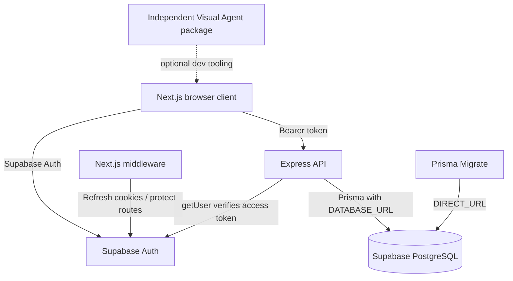
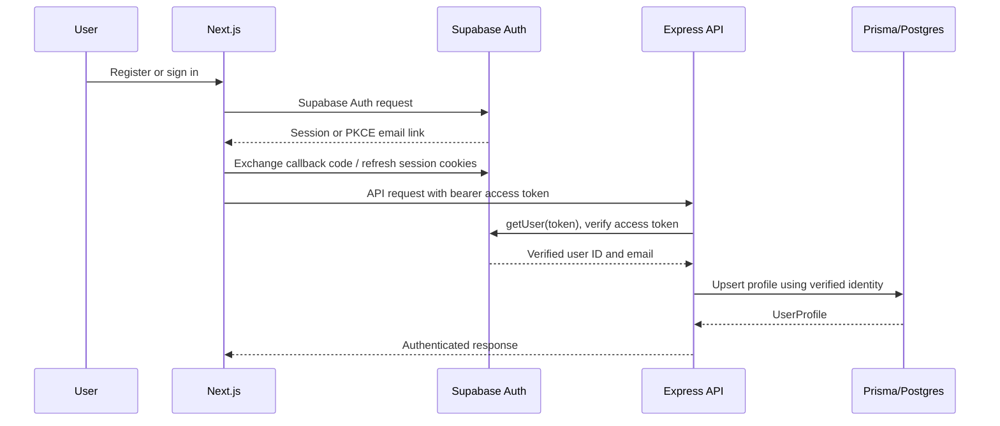
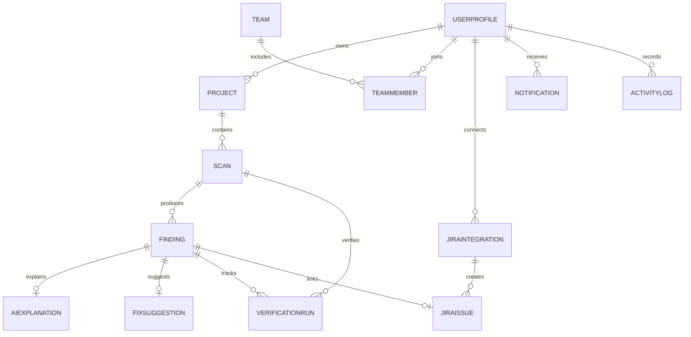
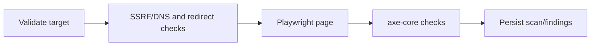
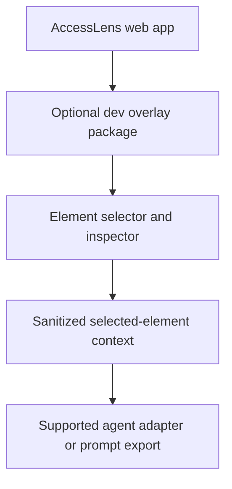
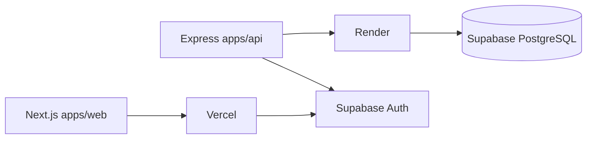

# AccessLens AI Project Knowledge Map

**Current development version:** v1.1.0
**Status:** Foundation, Supabase Auth wiring, profile API, and project CRUD are implemented. A live Supabase integration still requires project credentials.

## 1. Project overview

AccessLens AI is a modular accessibility SaaS monorepo. The current version provides Supabase Auth, a protected Next.js application shell, user profiles, and owner-scoped website projects. Website scanning, findings, AI, verification, Jira, analytics, teams, and notifications are planned modules, not implemented services.

The Visual Agent is a separate, optional package in `devtools/visual-agent-overlay`. The web app has no dependency on it.

## 2. Monorepo structure

```text
apps/
  web/
    src/app/                 Next.js App Router routes and layouts
    src/components/          Auth and app-shell components
    src/lib/                 Supabase browser client and API helper
    src/middleware.ts        Supabase cookie refresh and route protection
  api/
    src/app.ts               Testable Express app and implemented REST routes
    src/main.ts              Environment loading, Prisma connection, HTTP lifecycle
    src/modules/             Auth and repository contracts
    src/services/            Prisma-backed repository
    src/__tests__/           API authorization and CRUD integration tests
packages/
  database/
    prisma/schema.prisma     PostgreSQL enums and models
    prisma/migrations/       Initial PostgreSQL migration and RLS policies
    src/client.ts            Reused Prisma client and connection lifecycle
  shared/src/                Shared product types and module constants
devtools/
  visual-agent-overlay/      Independent development-only package
docs/                        Project architecture, API, database, deployment, control
scripts/                      Operational scripts
```

## 3. System architecture



## 4. Frontend modules and relationships

### Authentication
- **Purpose:** Registration, login, logout, email confirmation, and password recovery.
- **Path:** `apps/web/src/app/(auth)/`, `apps/web/src/components/auth/`, `apps/web/src/lib/supabase/`
- **Components:** `AuthForm`, browser Supabase client, callback route, auth route group.
- **APIs/models:** Supabase Auth; the API creates `UserProfile` on first verified API request.
- **Logic:** Supabase SSR uses PKCE and cookie-based sessions. Email verification and password recovery exchange their code through `/auth/callback`.
- **Dependencies:** `@supabase/ssr`, Supabase project configuration.
- **Related modules:** API auth middleware, profile, protected app shell.

### Protected application shell
- **Purpose:** Responsive navigation, profile summary, and logout action.
- **Path:** `apps/web/src/app/(app)/`, `apps/web/src/components/app-shell/`
- **Components:** `AppShell`, `FeaturePlaceholder`, profile/settings navigation, accessible toast provider.
- **APIs/models:** `GET /api/profile` backed by `UserProfile`.
- **Logic:** `src/middleware.ts` checks Supabase Auth for application routes. Future module routes show an explicit not-implemented state rather than invented data.
- **Dependencies:** Supabase browser client and API helper.
- **Related modules:** Profile, projects, all future app pages.

### Dashboard
- **Purpose:** Show the authenticated user's current project count and recent projects.
- **Path:** `apps/web/src/app/(app)/dashboard/`
- **Components:** Project summary and empty/loading/error states.
- **APIs/models:** `GET /api/projects`; `Project`.
- **Logic:** All visible project information is fetched from the API. Scan metrics are shown as unavailable, not fabricated.
- **Dependencies:** API helper.
- **Related modules:** Projects.

### Projects
- **Purpose:** Create, list, view, update, and delete websites owned by the signed-in user.
- **Path:** `apps/web/src/app/(app)/projects/`
- **Components:** Project create form, list, and detail editor.
- **APIs/models:** `GET/POST /api/projects`, `GET/PUT/DELETE /api/projects/:projectId`; `Project`.
- **Logic:** API responses are rendered with loading/error/empty states. Destructive deletion asks for confirmation.
- **Dependencies:** API helper and Supabase Auth session.
- **Related modules:** Dashboard, profile.

### Settings/Profile
- **Purpose:** View and update the signed-in user's name and avatar URL.
- **Path:** `apps/web/src/app/(app)/settings/`
- **Components:** Profile form.
- **APIs/models:** `GET/PUT /api/profile`; `UserProfile`.
- **Logic:** Identity and email come from the verified Supabase session; the API does not accept a client-selected user ID.
- **Dependencies:** API helper.
- **Related modules:** Auth, app shell.

### Planned modules
- **Purpose:** Scanner, Findings, AI Fixes, Verification, Jira, Analytics, Team, and Notifications routes are reserved.
- **Path:** `apps/web/src/app/(app)/{scanner,findings,ai-fixes,verification,jira,analytics,team,notifications}/`
- **Components:** `FeaturePlaceholder` only.
- **APIs/models:** None implemented for these screens.
- **Logic:** Explicitly label future functionality as unavailable in v1.1.0; no fake buttons or sample data.
- **Dependencies:** Shared authenticated layout.
- **Related modules:** To be defined when each feature is developed.

## 5. Authentication and profile flow



Passwords are stored and verified by Supabase Auth only. No AccessLens model stores password data. The API uses the Supabase public anon key to verify tokens and does not require the service-role key.

## 6. Backend APIs and relationships

### API app and middleware
- **Purpose:** Build the Express application, auth boundary, validation, and standard response/error handling.
- **Path:** `apps/api/src/app.ts`
- **Components:** `createApp`, Supabase token verifier, bearer-token middleware, Zod request schemas.
- **APIs/models:** All implemented `/api/*` handlers.
- **Logic:** Verify token with `supabase.auth.getUser(token)`, reject invalid tokens, initialize profile from trusted user identity, and scope project operations by `profileId`.
- **Dependencies:** Express, Supabase JS, Prisma repository contract, Zod.
- **Related modules:** Auth, profile, projects.

### API runtime and database
- **Purpose:** Load local configuration, connect to PostgreSQL, start HTTP service, and close resources on shutdown.
- **Path:** `apps/api/src/main.ts`
- **Components:** Prisma repository, `connectDatabase`, lifecycle handlers.
- **APIs/models:** `/health`.
- **Logic:** Startup fails explicitly if PostgreSQL is unreachable; health checks report database availability.
- **Dependencies:** `DATABASE_URL`, Prisma client, `PORT`.
- **Related modules:** All API modules.

### Profile
- **Purpose:** Create a profile for an authenticated Supabase user and manage safe profile fields.
- **Path:** `apps/api/src/modules/auth/`, `apps/api/src/app.ts`, `apps/api/src/services/prisma-project.repository.ts`
- **Components:** `AuthIdentity`, `ProfileRecord`, Prisma repository methods.
- **APIs/models:** `GET /api/auth/me`, `GET /api/profile`, `PUT /api/profile`; `UserProfile`.
- **Logic:** Upsert `authUserId`/email only from verified identity; profile edits cannot change identity, email, or role.
- **Dependencies:** Supabase Auth verification, Prisma.
- **Related modules:** Auth, projects, app shell.

### Projects
- **Purpose:** Provide authenticated project CRUD and pagination.
- **Path:** `apps/api/src/modules/projects/`, `apps/api/src/services/prisma-project.repository.ts`
- **Components:** `ProjectRepository`, `PrismaProjectRepository`, Zod validation.
- **APIs/models:** `GET/POST /api/projects`, `GET/PUT/DELETE /api/projects/:projectId`; `Project`.
- **Logic:** Each list/read/update/delete query includes the authenticated profile's owner ID. A project belonging to another user returns 404. URLs must be HTTP(S), valid, and have no embedded credentials.
- **Dependencies:** Prisma and verified auth context.
- **Related modules:** Profile, dashboard.

## 7. Database design



The Prisma schema is `packages/database/prisma/schema.prisma`. It defines 13 models: `UserProfile`, `Project`, `Scan`, `Finding`, `AIExplanation`, `FixSuggestion`, `VerificationRun`, `JiraIntegration`, `JiraIssue`, `Team`, `TeamMember`, `Notification`, and `ActivityLog`. Domain lifecycle fields use Prisma enums; `JiraIssue.status` remains a string because Jira workflows may define custom statuses. Unique constraints and indexes cover Supabase identity, user email, project ownership/name, team membership, Jira keys, and common access paths.

The initial migration enables RLS on all application tables. It defines authenticated self-read/safe-insert policies for `UserProfile` and owner access for `Project`; profile updates stay behind the validated API, and other tables currently have no client policies. The trusted backend DB role bypasses RLS, so API authorization and owner-scoped Prisma queries are mandatory. `DATABASE_URL` is used at runtime; `DIRECT_URL` is reserved for migrations.

## 8. Profile and project business rules

1. Supabase Auth is the identity provider; password values never enter app tables.
2. The API derives identity only from a successfully verified bearer token.
3. Profile creation is idempotent and occurs on the first successful authenticated API request.
4. Project ownership is always the authenticated profile ID, never a request body field.
5. List, detail, update, and delete queries all include owner ID.
6. URL validation checks syntax, HTTP(S), and absence of embedded URL credentials. Network-address/SSRF screening belongs to the future scanner before it makes outbound requests.
7. Project deletion cascades its scan data according to foreign-key policy.

## 9. Future accessibility scanning logic (not implemented)

The planned scanner will validate a destination, resolve/re-check DNS and redirects, run Playwright with resource/time limits, inject axe-core, store violations, and calculate an explicitly documented score. No scan is run in v1.1.0.



## 10. Future AI, verification, and Jira workflows (not implemented)

- **AI:** Finding context -> Gemini structured response -> Zod validation -> human-reviewed explanation/suggestion. Scanned content is untrusted; generated code is never executed automatically.
- **Verification:** New scan evidence -> compare finding identities -> mark resolved only when absent -> record regressions and score delta.
- **Jira:** Secure connection -> selected project -> deduplicate finding -> create issue -> save Jira key and finding link.

These are architectural targets only; v1.1.0 has no Gemini calls, Jira calls, scan comparisons, or generated issue records.

## 11. Visual Agent architecture



The package lives under `devtools/visual-agent-overlay`, is not imported by the frontend, and has no production database dependency. Direct Antigravity APIs are not assumed. Its current feature scope is tracked in its README; future frontend business logic must remain under `apps/web`.

## 12. Deployment architecture



Deployment configuration files are scaffolding and have not been used to verify a live deployment.

## 13. Environment variables

- `NEXT_PUBLIC_SUPABASE_URL` — Supabase URL used by the browser and SSR middleware.
- `NEXT_PUBLIC_SUPABASE_ANON_KEY` — public anon key for browser Auth flows.
- `NEXT_PUBLIC_API_URL` — Express API base URL.
- `SUPABASE_URL` — backend Supabase Auth project URL.
- `SUPABASE_ANON_KEY` — backend key used to verify bearer tokens via Auth.
- `DATABASE_URL` — pooled PostgreSQL runtime connection.
- `DIRECT_URL` — direct PostgreSQL migration connection.
- `FRONTEND_URL` — allowed Express CORS origin.
- `PORT` — Express listen port.
- `VISUAL_AGENT_ENABLED` — reserved dev-tool flag; not used by v1.1.0 web code.

No Supabase service-role key, Gemini key, or Jira credential is required by the implemented v1.1.0 integrations.

## 14. Dependencies

- Workspace: pnpm, Turborepo, TypeScript, Vitest
- Frontend: Next.js 14, React 18, Tailwind CSS, Lucide React, Recharts, Supabase SSR, Zod API validation
- Backend: Express 4, Supabase JS, Prisma, Zod, dotenv
- Database: Supabase PostgreSQL and Prisma Client/Migrate
- Visual Agent: isolated React package; not a web-app dependency

## 15. Completed and pending feature status

### Implemented in v1.1.0
- Supabase browser Auth, SSR cookie refresh, protected routes, PKCE callback, password recovery, and logout.
- Backend Supabase token verification, auth context, profile auto-creation and profile update.
- Prisma enums/models, client lifecycle utility, initial PostgreSQL migration, and RLS policies.
- Authenticated user project CRUD, pagination, URL validation, and owner-only repository access.
- Responsive application shell, data-backed dashboard/projects/settings, and explicit loading/error/empty states.
- Accessible success toast notifications for completed profile/project changes.
- API integration tests for invalid tokens, identity/profile creation, CRUD, and cross-user isolation.

### Not implemented
- Live database/auth credentials and live migrations
- Accessibility scanner and findings
- Gemini explanations/fix suggestions
- Verification/regression runs
- Jira OAuth and issue sync
- Analytics/report exports, teams/invitations, notifications, and audit events
- Production operation of Visual Agent

## 16. Known limitations and decisions

- Live authentication and PostgreSQL connectivity cannot be verified without a configured Supabase project.
- Automated API tests inject the auth verifier and repository; they validate application authorization, not Supabase's hosted service.
- The Prisma migration SQL is generated and schema-validated but not applied to a live database.
- RLS policies for future-owned tables must be added alongside their modules before direct Supabase access is enabled.
- The API uses a trusted backend database role; do not expose its connection string. Ownership checks in API methods are part of the security boundary.
- Supabase token verification uses `getUser(token)` rather than decoding an unverified JWT.
- The visual agent is independent and can be removed without affecting app imports.
